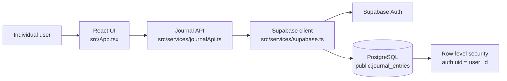

# Current architecture

Daily Journal is a static React/TypeScript Vite application. Vercel serves the production `dist` build. The browser connects directly to Supabase using the public project URL and publishable key; there is no custom application server.

## Frontend

- `src/main.tsx` mounts the React application.
- `src/App.tsx` contains the authenticated journal screen, date navigation, dialogs, entry loading, and autosave coordination.
- `src/components/AuthScreen.tsx` provides registration and login UI.
- `src/domain/DailyJournalEntry.ts` defines the entry, ratings, goals, morning, and evening TypeScript shapes.
- `src/services/journalApi.ts` is the UI's journal-data boundary. It reads the current session, calls Supabase Auth, loads, upserts, and deletes an entry.
- `src/services/supabase.ts` creates the typed Supabase browser client from `VITE_SUPABASE_URL` and `VITE_SUPABASE_PUBLISHABLE_KEY`.

The legacy `src/services/journalStorage.ts` reads and writes browser `localStorage`, but the current UI does not import it. It is retained without migration or fallback behavior.

## Authentication and authorization

The app restores the Supabase session on startup and subscribes to auth-state changes. Journal API calls require a current user. The client filters reads by that user's ID and writes it with each upsert, while the database RLS policies are the authorization boundary: they require `auth.uid() = user_id` for every journal operation.

## Entry loading and autosave

When the signed-in user or selected date changes, the app loads that date's row. An `AbortController` and increasing request sequence prevent stale loads from replacing newer state.

Edits update React state immediately. They are debounced for 700 ms, coalesced to the latest snapshot per date, and serialized per date. Each revision is checked before the UI reports Saved, so an older request cannot overwrite a newer pending edit in the client flow. Pending saves are flushed on sign-out, notebook close, and relevant field blur events.

Before deletion, the UI blocks conflicting edits, date changes, and sign-out; flushes queued and in-flight writes for the selected date; then deletes that authenticated user's row. It clears the screen only after deletion succeeds, invalidating stale loads and save revisions so an older client request cannot restore the deleted entry.

## Deployment and configuration

Vite reads the two public environment variables at build time. Vercel uses `npm run build`; no server-side Supabase secret or service-role key belongs in the frontend. The database schema is maintained through SQL migrations under `supabase/migrations/`.

## Historical journal search

The Search dialog in src/components/JournalSearch.tsx requests the authenticated user's complete history through src/services/journalApi.ts (100-row pages). A pure filter in src/domain/journalSearch.ts matches title, notes, priorities and evening reflections, case-insensitively. Results open a date using the existing load/autosave flow. Supabase RLS remains the authorization boundary; the API filters by user_id and rejects a changed session. This MVP does not add indexes or migrations; large journals may warrant server-side indexed search later.
