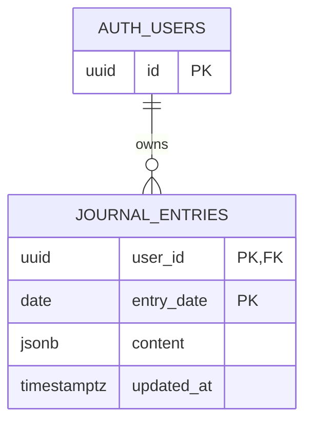

# Data model

The current database has one application table: `public.journal_entries`. Supabase Auth owns `auth.users`; it is referenced by the journal table and is not defined in this repository's migration.



## `public.journal_entries`

| Column | Type | Constraints and current behavior |
| --- | --- | --- |
| `user_id` | `uuid` | Required; defaults to `auth.uid()`; references `auth.users(id)` with cascade delete; first part of the primary key. |
| `entry_date` | `date` | Required; second part of the primary key. One user can have only one row for a date. |
| `content` | `jsonb` | Required; defaults to `{}`. The client stores the complete `DailyJournalEntry` object here. |
| `updated_at` | `timestamptz` | Required; defaults to `now()` and is reset by a `before update` trigger. |

The composite primary key is `(user_id, entry_date)`. Row-level security is enabled. Authenticated users have table privileges, but policies allow them to select, insert, update, and delete only rows whose `user_id` equals `auth.uid()`.

## JSON content shape used by the client

`content` is not normalized or constrained by the database beyond being JSON. The current TypeScript client writes this shape:

```ts
{
  date: 'YYYY-MM-DD',
  title?: string, // optional searchable title
  morning?: { energy?: 1..10, mood?: 1..10, focus?: 1..10 },
  goals?: Array<{ text: string, completed: boolean }>,
  notes?: string,
  evening?: {
    dayRating?: 1..10,
    whatWorked?: string,
    whatDidNotWork?: string,
    whatDidILearn?: string
  }
}
```

The `date` inside `content` duplicates `entry_date`; the current migration does not enforce that they match. The UI writes at most three goals, but that limit is also enforced by the UI rather than the database.

Source: [`supabase/migrations/20261012195000_create_journal_entries.sql`](../supabase/migrations/20261012195000_create_journal_entries.sql) and [`src/domain/DailyJournalEntry.ts`](../src/domain/DailyJournalEntry.ts).

Historical search uses the existing JSON content, fetching 100-row pages ordered by database entry_date through a user_id-filtered RLS-protected query. Title, notebook, priorities and evening reflections are filtered case-insensitively in memory. The database entry_date, rather than the JSON copy, determines result navigation. No migration or new index is required for this small-journal approach.
